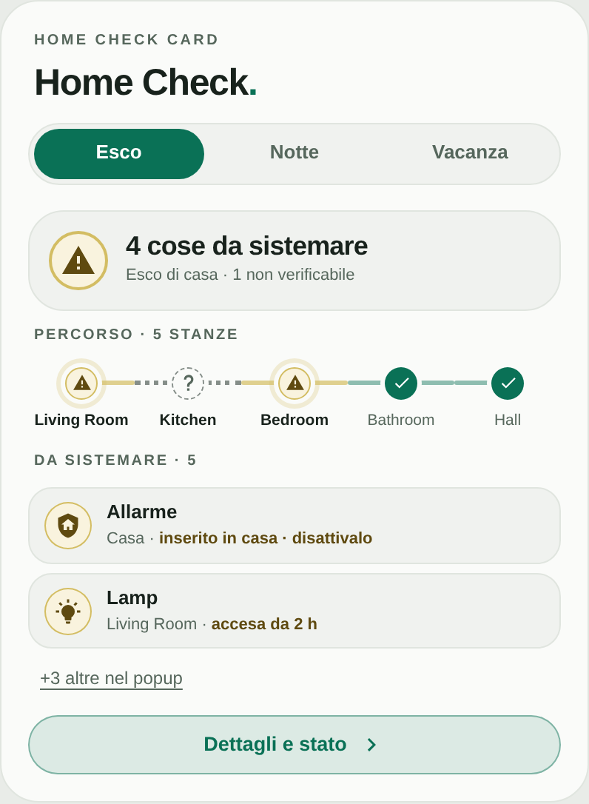
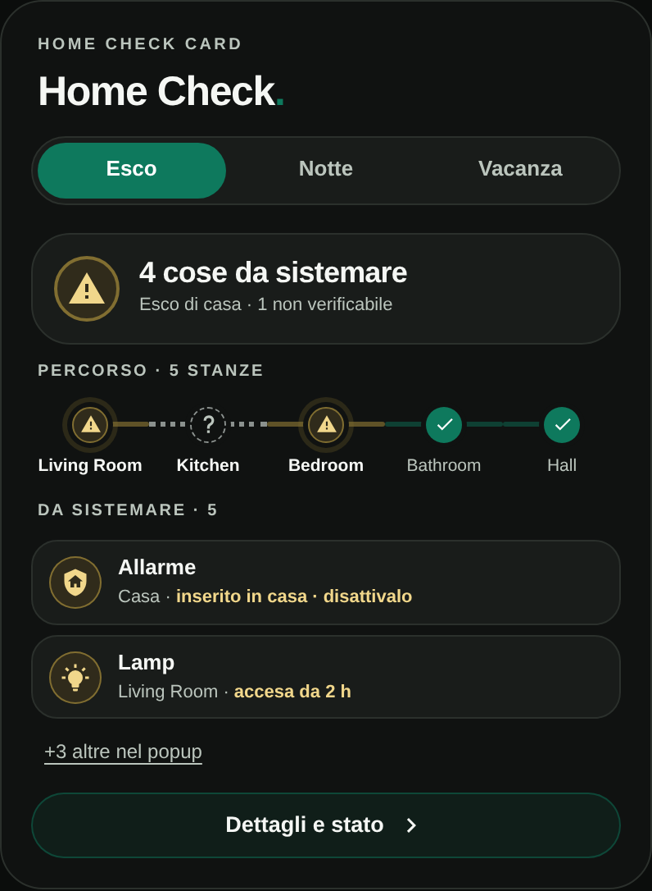
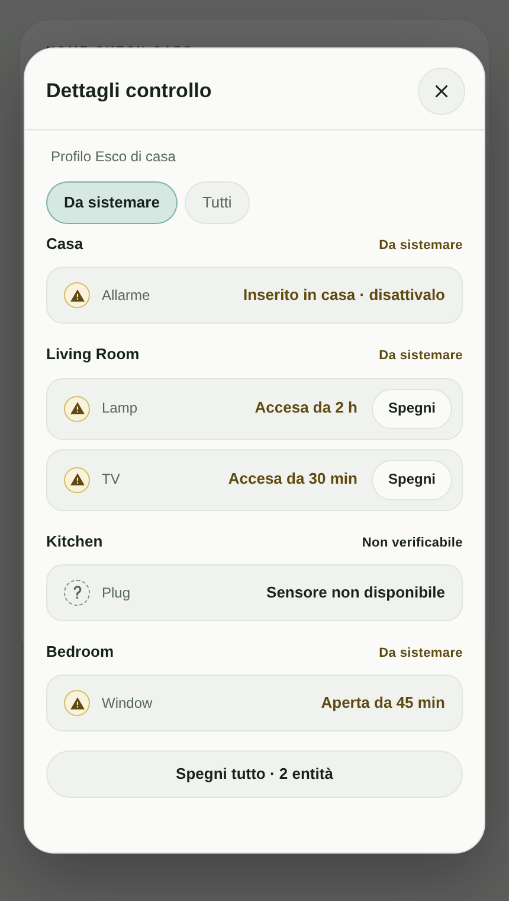
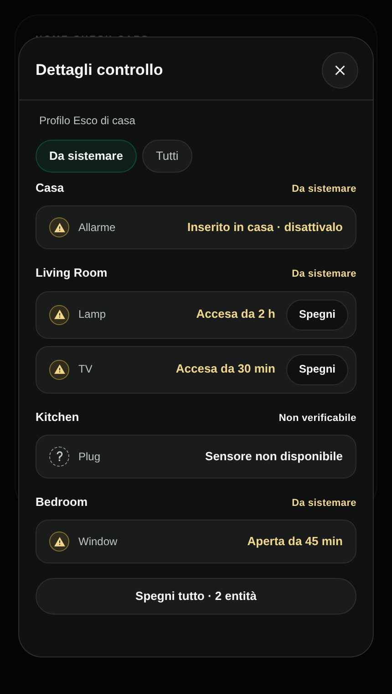

# Home Check Card

## Overview

**Home Check Card** is a custom check card for Home Assistant, designed with a minimalist, responsive interface inspired by the Edera Light and Dark visual styles.

It answers one question before you leave or go to bed: is everything in order? Choose a profile (Away, Night or Vacation) and the card checks your rooms, gives a single verdict, shows a route through the rooms and lists what still needs attention.

From the details popup you can switch off what is left on and, if you want, manage the alarm with a dedicated panel. Quick actions can be turned off in the editor, and locks are never commanded. The card uses entities and areas already configured in Home Assistant, is not tied to a specific device manufacturer and does not require a dedicated account, paid API, or subscription.

## Preview

  
  

  
  

*Home Check Card in Edera Light and Dark modes, with its details popup. The previews use demonstration values and do not display private installation data.*

## Features

- **Profiles:** Three profiles, **Esco** (Away), **Notte** (Night) and **Vacanza** (Vacation), each with its own set of checks.
- **Single verdict:** A clear result for the selected profile, a route through the rooms and a list of the things to fix.
- **Rooms from Home Assistant:** Rooms are read from your Home Assistant areas; choose which ones to include and in which order.
- **Checks:** Doors and locks, windows, lights, TVs, covers, plugs, water leaks and the alarm, enabled separately for each profile.
- **Alarm check:** The card tells you what to adjust: with the Away profile an alarm armed at home is reported, with Night the alarm is expected to be armed at home, with Vacation armed away.
- **Quick actions:** Optional buttons in the popup to switch off lights, TVs and plugs, one by one or all at once with a confirmation. Covers can get a **Close** button, disabled by default. Locks are never commanded.
- **Alarm panel:** A dedicated panel to disarm or arm the alarm according to the profile. The code keypad appears when the alarm entity has a code set in Home Assistant.
- **Details popup:** Fixed-height popup with filters for the items to fix (shown first) and for all items, and a tap to open the entity details.
- **Presence simulation:** Optional read-only status of a presence-simulation automation in the Vacation profile.
- **Edera appearance:** Automatic, Light, and Dark themes, a compact layout that adapts to the card width, rounded elements, and native Home Assistant icons.
- **Visual configuration:** Configure rooms, checks and options through the dashboard editor.

Unavailable or unknown entities are always reported as "not verifiable" and never counted as in order.

## Installation

### HACS — Custom repository

1. Open **HACS** in Home Assistant.
2. Select **Custom repositories** from the menu.
3. Enter `https://github.com/luigi-regolo/home-check-card`.
4. Select **Dashboard** as the repository type and add it.
5. Find **Home Check Card** in HACS and click **Download**.
6. Reload your dashboard if necessary.
7. Add **Home Check Card** to your dashboard and configure it using the visual editor.

## Configuration and Usage

### Visual editor

Open a dashboard in edit mode, add **Home Check Card**, and configure the available sections:

- **Controlli:** Profile to configure, categories checked for that profile, and the rooms (areas) to include, with their order.
- **Aspetto:** Header, title, theme and number of visible rows.
- **Avanzate:** Quick actions, alarm panel, tap behaviour, alarm entity and presence-simulation entity.

The editor uses native Home Assistant entity selectors where available.

### Main configuration options

All options are set from the visual editor. The table lists the field names saved in the card configuration.

| Option | Description |
|---|---|
| `title` | Card title. The green dot is added by the card. |
| `eyebrow` | Small label above the title. |
| `show_eyebrow` / `show_title` | Show or hide the label and the title. |
| `theme_mode` | `auto`, `light`, or `dark`. |
| `max_rows` | Visible items to fix, from 1 to 5. On phones the card shows at most 2. |
| `row_tap` | Tapping a row of the details popup opens the entity details. Enabled by default. The rows of the main card are informational only. |
| `row_actions` | Switch-off buttons on the rows of the popup. Enabled by default. |
| `bulk_action` | **Switch off all** button, with confirmation. Enabled by default. It does not include covers. |
| `cover_close` | **Close** button for covers. Disabled by default. |
| `alarm_panel` | Alarm panel opened from the alarm row. Enabled by default. |
| `default_profile` | Profile shown first: `esco`, `notte` or `vacanza`. |
| `rooms` | List of `area_id` and `on`, in route order. All areas by default. |
| `categories` | Per-profile switches for `door`, `window`, `light`, `tv`, `cover`, `plug`, `leak` and `alarm`. |
| `excluded` | Entities to ignore. |
| `alarm_entity` | Optional `alarm_control_panel` entity. |
| `simulation_entity` | Optional automation, input boolean or switch shown in the Vacation profile. |

Additional settings are available in the visual editor.

### Alarm rules

- **Esco:** an alarm armed at home is reported so that you can disarm it.
- **Notte:** the alarm is expected to be armed at home.
- **Vacanza:** the alarm is expected to be armed away.

The alarm panel sends the command that matches the profile. If the alarm entity has a code set in Home Assistant, the panel asks for it and Home Assistant verifies it. If no code is set, the command is sent without one, with a confirmation for disarming: set a code on the alarm entity if the dashboard is visible to other people.

## Compatibility and Requirements

Home Check Card requires:

- Home Assistant with support for custom JavaScript dashboard cards.
- Areas assigned to your devices or entities.
- HACS only when using the HACS installation method.

Supported entity types: `lock`, `binary_sensor` (door, window, opening, moisture), `light`, `cover`, `switch` (outlet), `media_player` (TV) and `alarm_control_panel`.

Quick actions use the standard Home Assistant services: `light.turn_off`, `media_player.turn_off`, `switch.turn_off`, `cover.close_cover` and, for the alarm, `alarm_control_panel.alarm_disarm`, `alarm_arm_home` and `alarm_arm_away`.

The card interface is currently in Italian.

No specific minimum Home Assistant version has been independently verified for this repository.

The card does not require a dedicated paid service or additional remote JavaScript libraries.

## Privacy and Security

Home Check Card operates through Home Assistant entities and the permissions of the authenticated user.

- Commands are sent only when you tap an action button or confirm in the alarm panel, with the permissions of the authenticated user. Quick actions can be disabled in the editor.
- Locks are never commanded.
- The selected profile is stored locally in your browser.
- The card does not include advertising, analytics, telemetry, or user-tracking services.

**Home Check Card is not a certified safety, intrusion detection or access control system.** A positive result only reflects the state reported by your entities.

Unknown, unavailable, or missing information must not be interpreted as confirmation that a property or device is safe.

## Releases

Published versions are available through [GitHub Releases](https://github.com/luigi-regolo/home-check-card/releases).

## Copyright & License

Copyright © 2026 luigi-regolo.

Original project created and maintained by **luigi-regolo**.

Licensed under the **GNU General Public License version 3 only (GPL-3.0-only)**.

See the [LICENSE](LICENSE) file for the complete license terms.

The software is provided without warranty to the extent permitted by applicable law.
